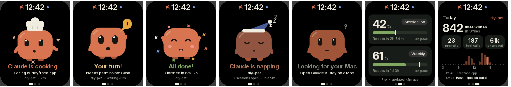
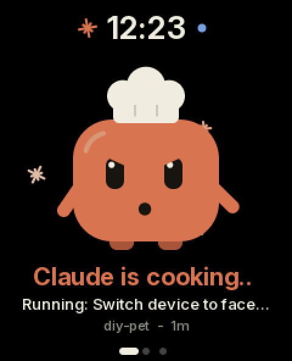
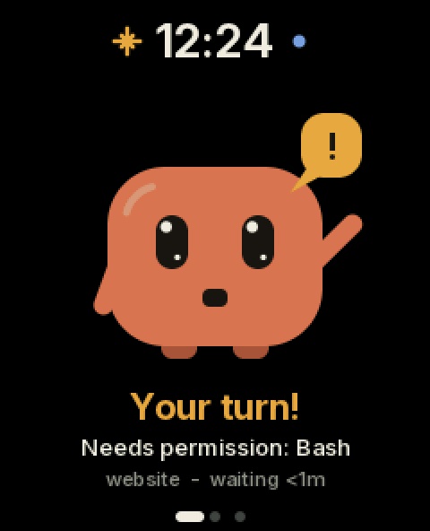
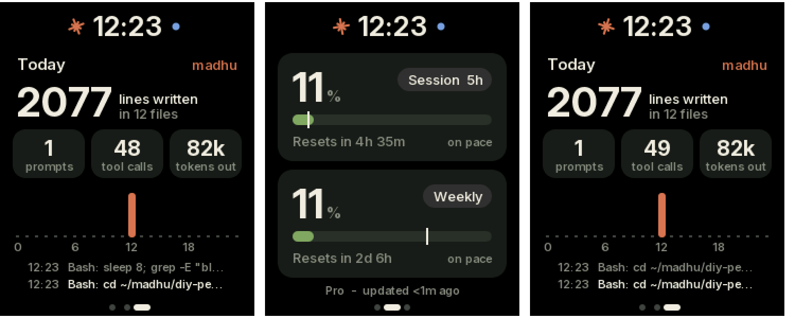

# Claude Buddy

A little desk companion that gives Claude Code a face. It runs on a
[Cheeko Gotchi](https://github.com/ALTIO-AI-PRIVATE-LIMITED/cheeko-gotchi)
(an ESP32-S3 handheld with a 240×296 touch screen) and talks over Bluetooth to
a menu bar app on your Mac.



## What it shows

Swipe left/right (or press + / −) between three pages. The time is always at the top.

1. **The buddy** acts out what Claude Code is doing on the Mac:
   - **Cooking**: chef hat and chopping arms, with what Claude is doing right now ("Editing face.cpp", "Running: build").
   - **Your turn!**: waves with a "!" bubble and chimes when Claude needs permission, asks a question or has a plan for you.
   - **All done!**: confetti and a jingle when a turn finishes.
   - **Napping**: nightcap and Zzz while nothing is happening.
   - Tap it to make it giggle, shake the device to make it dizzy, and tilt it to make it look around.
2. **Usage**: your plan's 5-hour session and weekly limits, with reset countdowns and a pace marker.
3. **Today**: lines of code written, files, prompts, tool calls, output tokens, activity by hour, and the latest actions.

Touch and hold anywhere for 1 second to turn sound on or off.

| Live on the device | Waiting for you | Usage and today |
| --- | --- | --- |
|  |  |  |

## Setup

### 1. The Mac app

Download `ClaudeBuddy-mac.zip` from [Releases](../../releases), unzip it and
move **Claude Buddy.app** to Applications. It runs on Apple silicon and Intel
Macs with macOS 12 or later. Then:

- **First launch:** the app isn't signed by Apple, so macOS blocks it the first
  time. Click **Open Anyway** in System Settings → Privacy & Security.
- **Bluetooth:** click **Allow** when it asks.
- **Claude Code** must be installed and signed in on that Mac.

Details, including what it changes in `~/.claude/settings.json`, are in
[mac/README.md](mac/README.md). To build it yourself, run `mac/build.sh`. It
needs only `swiftc`.

### 2. The device firmware

You need `arduino-cli` with the ESP32 core 3.3.x and the Adafruit GFX and
NimBLE-Arduino libraries. Then, with the device plugged into its unlabelled
USB-C port:

```sh
./pet.sh flash      # build + upload buddy/
./pet.sh monitor    # USB console: demo, page 2, status, shot
```

Type `demo` on the console to cycle through every mood without a Mac.

## How it works

```
Claude Code ──hooks──> ~/.claude-buddy/events.log ─┐
Keychain sign-in ──> api.anthropic.com/api/oauth/usage ─┤
~/.claude/projects/*.jsonl (today's transcripts) ───────┤
                                                        v
                                 Claude Buddy.app (menu bar)
                                                        │ Bluetooth LE, text lines
                                                        v
                                      Cheeko Gotchi: buddy/ firmware
```

- **Activity** comes from Claude Code hooks. A one-line shell script appends each event to a file, and the app reads it.
- **Usage** comes from the same endpoint `/usage` uses, with Claude Code's own token. The token is read only and never refreshed.
- **Today's numbers** are counted from Claude Code's transcripts.

The text protocol is in [buddy/PROTOCOL.md](buddy/PROTOCOL.md). Usage reading
and the card layout were inspired by
[Clawdmeter](https://github.com/HermannBjorgvin/Clawdmeter).

## Repository layout

| Path | What |
| --- | --- |
| `buddy/` | Claude Buddy firmware (Arduino sketch, C++). `main.cpp` pages, touch and clock. `face.cpp`, `meters.cpp`, `day.cpp` the three pages |
| `mac/` | The macOS menu bar app (one Swift file) and its build script |
| `lib/cheeko_board/` | Board support: display (JD9853), touch, accelerometer, sound, buttons, power |
| `tools/` | Font generator (`make_fonts.py`), device screenshots (`screenshot.py`), desktop renderer for the screens (`buddy_sim/render.sh`) |
| `cheeko/`, `ios/`, `plan.md` | The earlier firmware: Pip the virtual pet + bike navigation with an iPhone app. Flash it with `./pet.sh flash cheeko` |
| `MANUAL.md` | Hardware manual for the Cheeko Gotchi (buttons, power, ports, recovery) |

Hardware notes: the middle button is the power key (hold to power off, never
used by apps). The screen has rounded corners, so UI stays inside
`board::SAFE_X` near the top and bottom. `PSRAM=opi` is required.

Font: [Inter](https://rsms.me/inter/) (SIL Open Font License, `tools/fonts/OFL.txt`).
